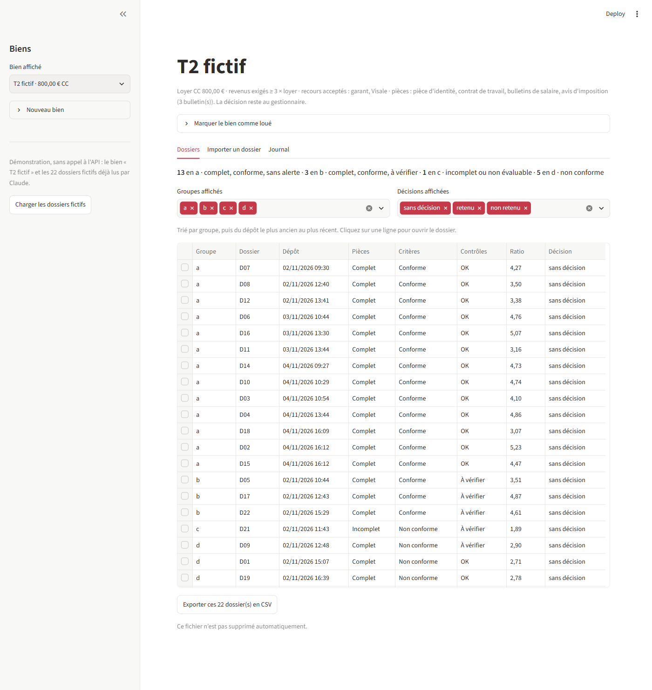
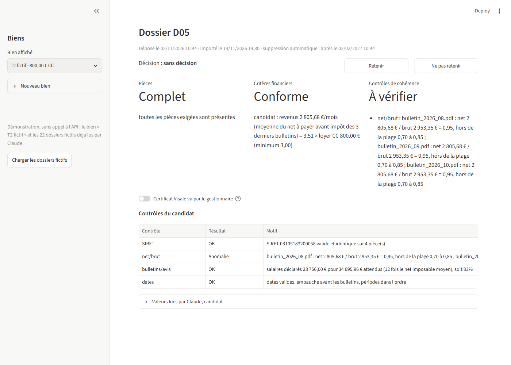

# Pré-tri locatif

Prototype d'aide au pré-tri des dossiers de candidature à une location. Il vérifie que
chaque dossier est complet, lit les justificatifs, signale les incohérences et applique
les critères financiers fixés pour le bien. La décision reste au gestionnaire.

Toutes les données du dépôt et des tests sont fictives.



## Le problème

En zone tendue, une annonce de location peut recevoir plus d'une centaine de dossiers
pour un même logement. Le gestionnaire doit vérifier que chaque dossier contient les
pièces demandées, calculer le rapport entre les revenus et le loyer, et repérer les
justificatifs falsifiés : bulletins de salaire retouchés, avis d'imposition modifiés,
numéros SIRET inventés, dates incohérentes. Fait à la main, ce travail est long, et les
dossiers arrivés en premier ne sont pas forcément examinés en premier.

## Ce que fait l'outil

- **Lecture des justificatifs.** Chaque PDF ou image est envoyé à l'API Claude, qui
  renvoie les valeurs imprimées dans un format fixé : employeur, SIRET, type et dates du
  contrat, période, salaire brut, net à payer, net imposable, salaires déclarés et revenu
  fiscal de référence. Les dates sont recopiées telles qu'imprimées, même impossibles.
  Ni nom, ni adresse, ni date de naissance ne sont extraits.
- **Contrôles de cohérence**, faits en Python, sans modèle :
  - clé de Luhn du SIREN et du SIRET, et même SIRET sur toutes les pièces ;
  - rapport net/brut entre 0,70 et 0,85 sur chaque bulletin ;
  - salaires déclarés sur l'avis comparés à 12 fois le net imposable moyen (écart
    au-delà de 20 % signalé) ;
  - dates qui existent, embauche antérieure aux bulletins, périodes dans l'ordre.
- **Critères du bien** : loyer charges comprises, ratio minimum revenus/loyer, garant
  accepté ou non, Visale acceptée ou non, pièces exigées.
- **Tri** : les dossiers sont rangés en quatre groupes (voir plus bas), puis du dépôt le
  plus ancien au plus récent.
- **Détail par dossier** : chaque statut est accompagné de son motif chiffré, et chaque
  contrôle de son résultat.
- **Suivi** : décision du gestionnaire par dossier, passage du bien à « Loué », journal
  horodaté, export CSV de la sélection affichée.



*Dossier fictif D05 : les revenus atteignent le ratio, mais le net vaut 95 % du brut
sur les trois bulletins. Le dossier est classé « À vérifier », pas écarté.*

## Ce que l'outil ne fait pas

- **Il ne décide jamais.** Aucun libellé ne dit « refusé » ; un test le vérifie. Retenir
  ou non un dossier est une action du gestionnaire, et elle est journalisée comme telle.
- Il ne calcule pas de note globale. Les trois statuts restent séparés.
- Une alerte n'est pas une accusation de fraude. Elle demande une vérification humaine.
  Une donnée illisible donne « non vérifiable » ou « Non évaluable », jamais un échec.
- Il ne reconnaît pas le certificat Visale : le gestionnaire coche une case après l'avoir
  vu.
- Il ne conserve pas les fichiers reçus : seules les valeurs lues sont gardées, et elles
  sont supprimées selon les règles ci-dessous.

## Choix juridiques

Ces choix sont ceux du projet. Ils n'ont pas fait l'objet d'une validation par un juriste.

### Critères autorisés

- L'outil ne retient que des critères financiers et documentaires : revenus, ratio
  revenus/loyer, garant, garantie Visale, complétude des pièces. Le type et l'ancienneté
  du contrat de travail sont autorisés par les règles du projet mais ne sont pas encore
  appliqués.
- Aucun critère ne porte sur la personne (âge, sexe, nationalité, nom, adresse
  d'origine, situation familiale, photo). Ces données ne sont pas extraites, et la pièce
  d'identité sert seulement à vérifier qu'elle est présente.
- Les pièces exigibles se limitent à celles du décret n° 2015-1437 du 5 novembre 2015 que
  l'outil sait reconnaître : pièce d'identité, contrat de travail, un à trois derniers
  bulletins de salaire, avis d'imposition. Créer un bien qui exige une autre pièce est
  refusé.
- Chaque dossier reçoit une référence (D01, D02…), jamais le nom du candidat.

### Trois statuts

Chaque dossier reçoit trois statuts indépendants, chacun avec son motif :

| Statut | Valeurs | Ce qu'il mesure |
|---|---|---|
| Pièces | Complet / Incomplet | les pièces exigées par le bien sont présentes |
| Critères | Conforme / Non conforme / Non évaluable | revenus (moyenne du net à payer des bulletins) ≥ ratio × loyer, ou à défaut garant au ratio, ou Visale |
| Contrôles | OK / À vérifier | les quatre contrôles de cohérence, sur le candidat et sur le garant |

Les dossiers sont ensuite rangés en quatre groupes :

- **a** : Complet, Conforme, OK
- **b** : Complet, Conforme, À vérifier
- **c** : Incomplet, ou Non évaluable
- **d** : Non conforme (dossier complet)

Les comparaisons d'argent se font en centimes, en nombres entiers, pour qu'un arrondi ne
fasse pas basculer un dossier situé juste au ratio.

### Conservation des données et purge

Les valeurs lues sur les pièces sont des données personnelles. Elles sont supprimées
automatiquement :

| Situation | Suppression |
|---|---|
| Dossier sans décision | 3 mois après le dépôt |
| Dossier non retenu | 3 mois après la décision ; une date déjà fixée n'est jamais avancée |
| Bien passé à « Loué » | les dossiers sans décision deviennent « non retenu » à la date de clôture |
| Dossier retenu | jamais |

La suppression emporte les valeurs lues, les motifs (qui citent des montants) et les
statuts.

### Journal sans donnée personnelle

Chaque action est écrite dans un journal horodaté : création d'un bien, lecture par
Claude, import, évaluation, décision, passage à « Loué », purge, export. Le journal ne
contient que des références de dossier, des statuts, des dates de gestion, des compteurs
et les critères du bien. Il refuse toute autre information : ni montant lu, ni employeur,
ni motif, ni nom de fichier. Il est conservé après la purge des dossiers.

### Export CSV

L'export contient la référence, les dates, les statuts et la décision, sans montant, ratio
ni motif. Une fois téléchargé, le fichier sort de l'outil et n'est pas supprimé
automatiquement ; l'interface l'indique sous le bouton.

## Installation et lancement sous Windows

Prérequis : Python 3.11 ou plus récent, Git, et une clé API Anthropic pour lire de
nouveaux justificatifs.

```
git clone https://github.com/Therm26/pretri-locatif.git
cd pretri-locatif
python -m venv .venv
.\.venv\Scripts\python.exe -m pip install -r requirements.txt
copy .env.example .env
```

Ouvrir `.env` et y coller la clé API après `ANTHROPIC_API_KEY=`. Ce fichier n'est jamais
versionné.

### Données fictives

Le dossier `data/` n'est pas versionné. Pour créer les 22 dossiers fictifs (PDF et zip) :

```
.\.venv\Scripts\python.exe -m scripts.generer_dossiers
```

Quatre dossiers contiennent une anomalie volontaire : D05 (net incohérent avec le brut),
D09 (SIRET invalide), D13 (avis d'imposition incohérent avec les bulletins), D17 (date
impossible). D21 n'a pas d'avis d'imposition et D22 a un net illisible sur un bulletin.

Pour utiliser le bouton « Charger les dossiers fictifs » de l'interface, il faut d'abord
faire lire ces dossiers par Claude. Cela représente 131 appels payants :

```
.\.venv\Scripts\python.exe -m scripts.evaluer_extraction
```

On peut aussi importer un seul zip de `data\fake\zips\` depuis l'onglet « Importer un
dossier » (6 appels).

### Lancer l'interface

```
.\.venv\Scripts\python.exe -m streamlit run app.py
```

Puis ouvrir http://localhost:8501. La base SQLite est créée dans `data\pretri.db` ; une
autre base peut être choisie avec la variable d'environnement `PRETRI_BASE`.

### Tests

```
.\.venv\Scripts\python.exe -m pytest
```

Les tests n'appellent pas l'API.

## Limites connues

- **PDF générés uniquement.** Tous les justificatifs ont été produits par le script du
  projet, avec une mise en page simple et régulière. Sur ces 22 dossiers, la lecture par
  Claude retrouve les 550 valeurs attendues.
- **Pas testé sur de vrais scans.** Photos de travers, scans de mauvaise qualité,
  bulletins de logiciels de paie différents : rien de tout cela n'a été essayé. Le taux
  de lecture mesuré sur les PDF générés ne s'y transpose pas.
- **Incomplet et Non conforme vont en groupe c.** Un dossier à la fois incomplet et sous
  le ratio est rangé en c (« incomplet ou non évaluable »), pas en d. C'est le cas du
  dossier fictif D21. Filtrer le groupe d ne montre donc pas tous les dossiers sous le
  ratio.
- **Seuils fixés à la main.** Les bornes net/brut (0,70 à 0,85) et l'écart toléré entre
  l'avis et les bulletins (20 %) n'ont pas été calibrés sur des données réelles.
- **Pièces reconnues limitées** à quatre types. Les autres pièces du décret (quittances,
  justificatifs pour indépendants, retraités ou étudiants) ne sont pas prises en charge.
- **Purge à l'ouverture.** La suppression des dossiers périmés est lancée à chaque
  affichage de l'interface. Si l'interface n'est pas ouverte, rien n'est supprimé.
- **Envoi à un service extérieur.** Les justificatifs sont transmis à l'API d'Anthropic
  pour être lus. Un usage sur de vrais dossiers demanderait de vérifier ce traitement au
  regard du RGPD.
- **Prototype mono-utilisateur**, sans authentification.
